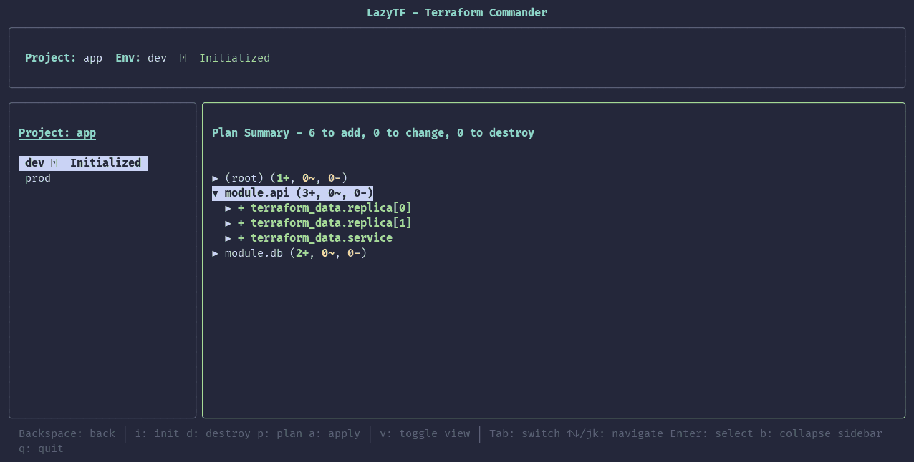
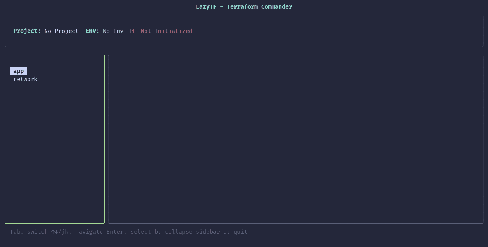
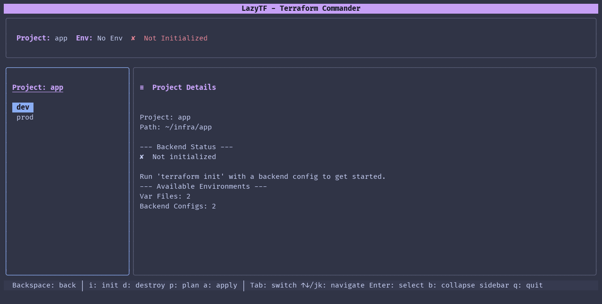
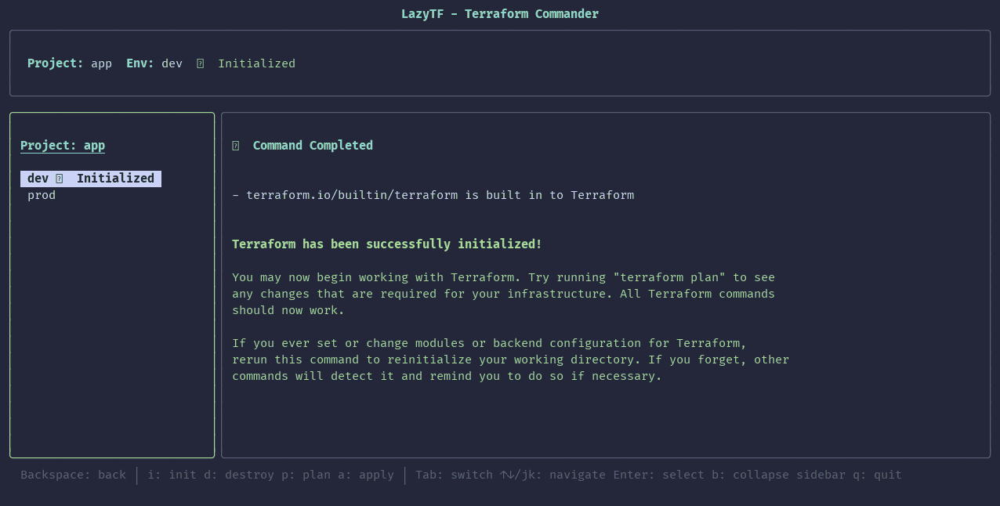
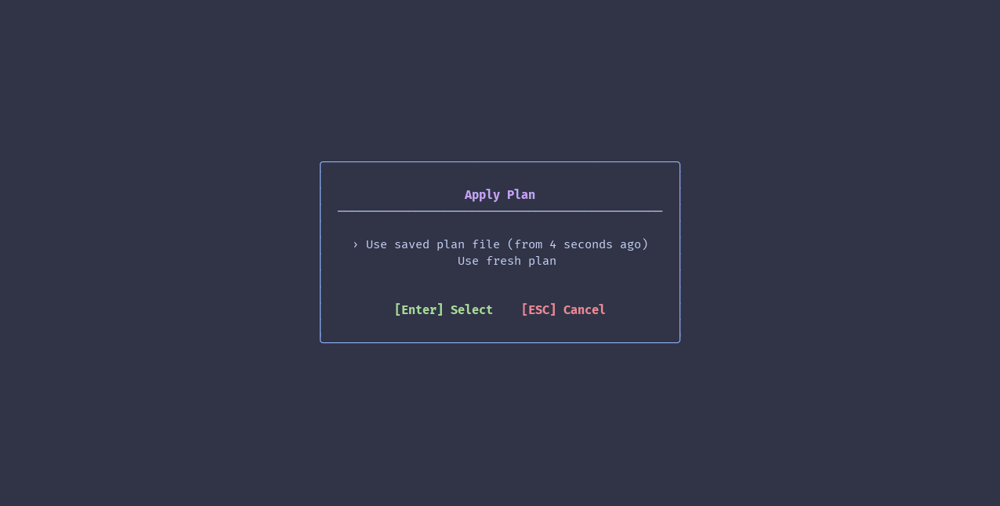
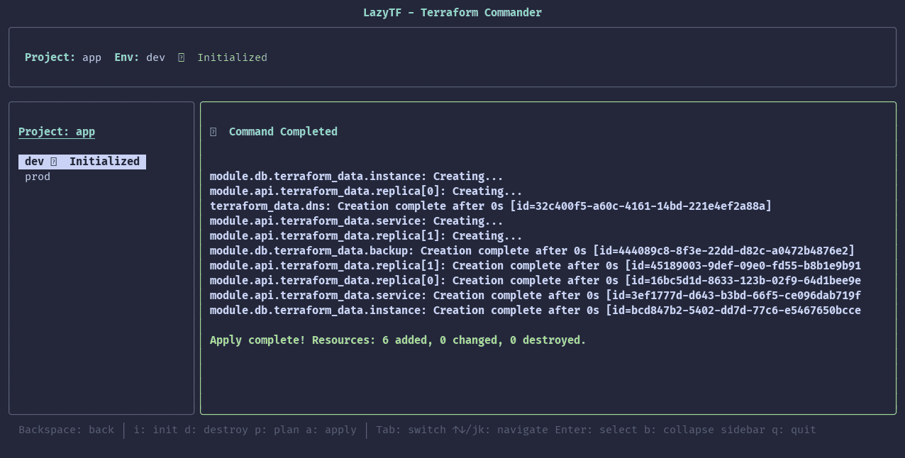

# LazyTF

[](https://github.com/Nicolas-Rigaudy/lazytf/actions/workflows/ci.yml)
[](https://github.com/Nicolas-Rigaudy/lazytf/releases)
[](LICENSE)

**A terminal UI for Terraform: pick an environment, then init, plan, apply or destroy with one key.**

LazyTF brings lazygit-style ergonomics to Terraform. It finds the projects and environments in your repo, runs Terraform with the right var file and backend config, streams the output, and turns a plan into a summary you can browse by module.

<!--
  DEMO GIF SLOT (reserved for the maintainer).
  Replace the screenshot below with the animated demo once it is recorded, e.g.
  
-->


- [Why LazyTF?](#why-lazytf)
- [Demo](#demo)
- [Installation](#installation)
- [Usage](#usage)
- [Configuration](#configuration)
- [How it keeps you safe](#how-it-keeps-you-safe)
- [Key bindings](#key-bindings)
- [Compared with other Terraform UIs](#compared-with-other-terraform-uis)
- [Contributing](#contributing)

---

## Why LazyTF?

Running Terraform day to day means retyping the same long commands for every environment, keeping track of which backend the working directory was last initialised with, and reading plans as a wall of text.

```bash
# Without LazyTF
terraform init -backend-config=backends/dev.hcl -reconfigure
terraform plan -var-file=envs/dev.tfvars -out=dev.tfplan
terraform apply dev.tfplan

# With LazyTF
Enter → pick the project, then the "dev" environment
i     → init with the matching backend config, after a confirmation
p     → plan, streamed, then shown as a summary grouped by module
a     → apply the saved plan
```

## Features

- **Projects and environments in a sidebar.** Every directory with `.tf` or `.tf.json` files is a project; every var file is an environment.
- **Backend matching.** `backend_dev.tfvars` or `dev.hcl` goes with the `dev` environment, and LazyTF remembers which one the last `init` used.
- **Streaming output** from every Terraform command.
- **Plan summary.** A navigable diff grouped by module (toggle with `v`).
- **Apply from the saved plan**, with its age shown and a warning if it predates the last init.
- **Destroy behind a confirmation.**
- **Any layout.** Var files and backend configs are found by globs you can change per repo.
- **Terraform or OpenTofu**, or any other compatible binary.
- **Optional login** for AWS SSO, `gcloud`, `az` or your own command, with a retry of the failed command afterwards.
- **One static binary** for Linux and macOS. Colours follow your terminal theme.

---

## Demo

Recorded on the sample repo in [`docs/demo/sample`](docs/demo/sample): a project `app` with `dev` and `prod` var files, two modules and a local backend, plus a project `network` with no var file. Nothing in it talks to a cloud account.

**1. Discover.** Run `lazytf` at the top of the repo: every Terraform project is listed.



**2. Pick an environment.** Inside a project, each var file is an environment.



**3. Init.** `i` initialises the environment with its backend config, after a confirmation.



**4. Plan and summary.** `p` streams the plan, then shows it grouped by module; `Enter` expands a module or a resource, `v` switches to the raw output.


**5. Apply.** `a` offers the plan you just saved, or a fresh one.





The screenshots come from [`docs/demo/record.py`](docs/demo/record.py), which runs LazyTF on a copy of the sample repo and saves each screen; see [Recording the demo](#recording-the-demo).

---

## Installation

| Method | Command | Platforms | Status |
|--------|---------|-----------|--------|
| [GitHub releases](#prebuilt-binary-github-releases) | download an archive | Linux, macOS (amd64, arm64) | available |
| [`go install`](#go-install) | `go install github.com/Nicolas-Rigaudy/lazytf/cmd/lazytf@latest` | any Go target | available |
| [From source](#from-source) | `go build ./cmd/lazytf` | any Go target | available |
| [AUR](#aur-arch-linux) | `yay -S lazytf-bin` | Arch Linux | coming with 1.0 |
| [Homebrew](#homebrew) | `brew install Nicolas-Rigaudy/tap/lazytf` | macOS, Linux | coming with 1.0 |

### Prebuilt binary (GitHub releases)

No Go toolchain needed. On Linux, download the latest release and install it to `/usr/local/bin`:

```bash
curl -sL https://github.com/Nicolas-Rigaudy/lazytf/releases/latest/download/lazytf_Linux_amd64.tar.gz | tar xz
sudo mv lazytf /usr/local/bin/
```

On a 64-bit ARM machine (a Graviton instance, a Raspberry Pi with a 64-bit OS), swap `amd64` for `arm64`. Every archive is also on the [Releases page](https://github.com/Nicolas-Rigaudy/lazytf/releases), with `checksums.txt`.

**macOS.** Archives for Intel (`lazytf_Darwin_amd64.tar.gz`) and Apple Silicon (`lazytf_Darwin_arm64.tar.gz`) are published from the first release after v0.1.0. They are not code-signed, so Gatekeeper blocks the first run of a binary downloaded with a browser. Clear the quarantine flag once:

```bash
tar xzf lazytf_Darwin_arm64.tar.gz
xattr -d com.apple.quarantine lazytf
sudo mv lazytf /usr/local/bin/
```

Downloading with `curl`, as in the Linux example, does not set the flag.

### `go install`

```bash
go install github.com/Nicolas-Rigaudy/lazytf/cmd/lazytf@latest
```

This puts `lazytf` in `$(go env GOPATH)/bin`. Until the next release, `@latest` is v0.1.0, which predates the layout and login settings below and the `--version` flag; `@main` installs the current code, and `lazytf --version` then reports the module version.

### From source

```bash
git clone https://github.com/Nicolas-Rigaudy/lazytf
cd lazytf
go build -o lazytf ./cmd/lazytf
sudo mv lazytf /usr/local/bin/
```

### AUR (Arch Linux)

*Coming with 1.0.* The `lazytf-bin` package will install the release binary:

```bash
yay -S lazytf-bin
```

### Homebrew

*Coming with 1.0.* The tap will serve macOS and Linux:

```bash
brew install Nicolas-Rigaudy/tap/lazytf
```

### Requirements

- `terraform` on your `PATH`, or another compatible binary set with [`terraform:`](#project-layout)
- The `aws`, `gcloud` or `az` CLI only if you turn on that [login provider](#login)
- Go 1.25+ only to build from source or use `go install`

---

## Usage

Run `lazytf` in a Terraform project, or in a directory that holds several:

```bash
lazytf                 # the current directory: one project, or a scan for projects
lazytf ~/infra/app     # open that project
lazytf ~/infra         # scan that directory for projects
lazytf --config ./lazytf.yml
lazytf --version       # also: --help
```

If `terraform` is not on your `PATH`, LazyTF says so and exits before drawing anything.

### How LazyTF finds your projects

Nothing needs configuring to start. LazyTF works by convention, and every convention can be changed (see [Project layout](#project-layout)):

- **One project or many.** If the directory holds Terraform files (or a `.terraform/` folder), LazyTF opens it directly, initialised or not. Otherwise it scans the directory for projects and lists them. It never scans folders you did not name. A project is any directory with `.tf` or `.tf.json` files (the JSON syntax that CDKTF and other generators write).
- **Environments.** Each var file is an environment: `dev.tfvars` is `dev`. By default LazyTF looks in the project root and in `variables/`, `env/` and `tfvars/`. `terraform.tfvars` and `*.auto.tfvars` are not environments, since Terraform loads them by itself. A project with no var file gets one environment, `(no var-file)`, so it can still be planned.
- **Backend configs.** Files passed to `init` as `-backend-config`. By default they are looked for under `variables/backend/`; `backend_dev.tfvars` or `dev.tfvars` goes with `dev`, and a plain `backend.tfvars` with every environment. A project with no backend config file (local state, or a backend written in the `.tf` files) is initialised without `-backend-config`.
- **Which environment is initialised.** LazyTF records the environment and backend file of its last `init` (in `~/.cache/lazytf/init/`) and checks them against the backend Terraform recorded in `.terraform/`. If you re-init by hand, it falls back to guessing from the state key.

---

## Configuration

Both files below are optional, and any key you leave out keeps its default.

### Search paths

To list projects from several places, create `~/.config/lazytf/config.yml`:

```yaml
search_paths:
  - ~/infra
  - ~/work/terraform
ignore_patterns:
  - "*/node_modules"
  - "*/.git"
  - "*/vendor"
  - "*/.terraform"
```

By default LazyTF searches only the current directory. A file with only `search_paths` still uses the ignore patterns above.

### Project layout

If your repo does not follow the defaults, say where things are. Put a `.lazytf.yml` in the project root, or the same keys in `~/.config/lazytf/config.yml` to set them for every project (a key in `.lazytf.yml` wins). Globs are relative to the project root; `**` spans directories.

| Key | Meaning | Default |
|-----|---------|---------|
| `var_files` | Globs whose matches are environments | `*.tfvars`, `variables/*.tfvars`, `env/*.tfvars`, `tfvars/*.tfvars` |
| `backend_configs` | Globs of files passed as `-backend-config` | `variables/backend/**/*.tfvars` |
| `exclude` | Var files that are not environments (a glob without `/` matches the file name) | `terraform.tfvars`, `*.auto.tfvars` |
| `include` | Var files to list even when `exclude` matches | none |
| `env_pattern` | Regex with one capture group, applied to the var file name without extension | the whole name |
| `backend_env_pattern` | Same, for backend config files | `backend_<env>` or the whole name; a bare `backend` is shared |
| `terraform` | Executable to run, e.g. `tofu` or a full path | `terraform` |

`exclude: []` clears a default list. Three common layouts:

```yaml
# 1. envs/dev.tfvars with backends/dev.hcl (a GCS or S3 backend, say)
var_files: ["envs/*.tfvars"]
backend_configs: ["backends/*.hcl"]
```

```yaml
# 2. A local backend and one var file per environment: nothing to configure.
#    With no backend config file, init runs without -backend-config.
```

```yaml
# 3. Var files named vars-<env>.tfvars next to the code, run with OpenTofu
var_files: ["vars-*.tfvars"]
env_pattern: '^vars-(.+)$'
terraform: tofu
```

### Login

LazyTF does nothing about credentials unless you name an auth provider. Then it does two things: `L` runs the login command, and when a command fails with that provider's expired-credentials error, it offers to log in and re-runs the failed command afterwards. Set it in `~/.config/lazytf/config.yml` or per repo in `.lazytf.yml`:

```yaml
auth:
  provider: gcloud   # or aws-sso, az, custom
```

| Provider | Login command | Recognised errors (examples) |
|----------|---------------|------------------------------|
| `aws-sso` | `aws sso login --sso-session <name>`, session picked from `~/.aws/config` | `No valid credential sources found`, `Unable to locate credentials`, `ExpiredToken` |
| `gcloud` | `gcloud auth application-default login` | `could not find default credentials`, `Reauthentication required` |
| `az` | `az login` | `Please run 'az login'`, `AADSTS70043` |
| `custom` | your `login` list | your `error_patterns` |

```yaml
auth:
  provider: custom
  login: ["my-sso-tool", "login", "--browser"]
  error_patterns: ["session expired"]   # matched without regard to case; also extends the presets
```

`login` overrides a preset's command too. To use another account or profile per environment, set variables under `auth.env`; they are added to every Terraform command and to the login command for that environment:

```yaml
auth:
  provider: aws-sso
  env:
    dev:  { AWS_PROFILE: dev-profile }
    prod: { AWS_PROFILE: prod-profile }
```

Upgrading from 0.1: the AWS SSO login used to be on by default; add `provider: aws-sso` to keep it.

---

## How it keeps you safe

- **Nothing runs without a key press, and the risky ones ask first.** `init` and `destroy` open a confirmation. An apply without a saved plan shows Terraform's own plan and waits for `y`.
- **Saved plans stay with their environment.** A plan is saved per project and environment, so `a` never offers another environment's plan. The apply menu shows the plan's age and warns when it is older than the last `init`, since it may then target another backend. Plans can hold sensitive values, so they live in your user cache directory (`~/.cache/lazytf/plans/` on Linux) with owner-only permissions, not in `/tmp`.
- **No credential storage.** LazyTF asks for no secret and stores none. With a login provider it runs that provider's own CLI, and `auth.env` only sets the variables you wrote. With the `aws-sso` provider it reads `~/.aws/config` to list SSO session names.
- **No hidden prompts.** Plan, apply and destroy run with `-input=false`, so a missing variable fails at once instead of waiting on a prompt you cannot see.
- **No surprise scans.** LazyTF reads only the directory you start it in or name on the command line, or the ones listed in `search_paths`.

---

## Key bindings

| Key | Action |
|-----|--------|
| `i` | Init the selected environment |
| `p` | Plan |
| `a` | Apply (offers the saved plan if there is one) |
| `d` | Destroy (after a confirmation) |
| `L` | Log in with the configured provider (hidden when none is set) |
| `v` | Toggle plan summary / raw output |
| `b` | Collapse / expand the sidebar |
| `j/k` or `↑/↓` | Move in a list, scroll output |
| `h/l` or `←/→` | Scroll output sideways |
| `Tab` | Switch between sidebar and output |
| `Enter` | Select |
| `Esc` / `Backspace` | Back |
| `?` | Help |
| `q` | Quit |

In the plan summary, `ctrl+j/k` moves between rows, `alt+j/k` jumps between modules and `Enter` expands a module or a resource.

---

## Compared with other Terraform UIs

- **[terraform-tui](https://github.com/idoavrah/terraform-tui) (`tftui`)** is a terminal UI built around the state: browse and search the state tree, read resources, taint, untaint or remove them, and plan and apply in one working directory. Pick it to inspect and edit state.
- **Web UIs such as [terraform-ui](https://github.com/mohnishbasha/terraform-ui)** run as a server and drive Terraform from a browser.
- **LazyTF** is built around environments: it finds every project and var file in a repo, pairs each environment with its backend config, and remembers which one is initialised. It is a single binary that needs only Terraform, and it changes state only through `init`, `plan`, `apply` and `destroy`.

---

## Contributing

Issues and pull requests are welcome; the [issue templates](https://github.com/Nicolas-Rigaudy/lazytf/issues/new/choose) ask for what helps reproduce a problem.

### Running the tests

```bash
go test ./...                                                       # unit tests
go test -tags integration -run Integration -v ./internal/terraform  # real init/plan/apply, needs terraform on PATH
```

The integration test copies `internal/terraform/testdata/fixture` (local backend, `null` provider) to a temporary directory, so it never touches your state.

### Recording the demo

```bash
go build -o build/lazytf ./cmd/lazytf
python3 docs/demo/record.py build/lazytf build/demo   # needs Python 3, pyte and terraform
```

This writes one ANSI screen per step (`build/demo/*.ans`); turn them into images with any ANSI-to-PNG renderer (`--plain-symbols` helps one without a colour emoji font). The sample repo is copied first, so no state or `.terraform/` ends up in `docs/`.

### Project structure

```
lazytf/
├── cmd/lazytf/         # Entry point, flags and start-up checks
├── docs/demo/          # Sample repo, recorder and README screenshots
└── internal/
    ├── config/         # Config loading (YAML, XDG-compliant)
    ├── executor/       # Streaming command executor
    ├── auth/           # Login providers: aws-sso, gcloud, az, custom
    ├── aws/            # AWS SSO session discovery
    ├── terraform/      # Discovery and command builders: init, plan, apply, destroy
    └── ui/             # Bubble Tea components: model, sidebar, panels, modals
```

Built with [Go](https://go.dev/), [Bubble Tea](https://github.com/charmbracelet/bubbletea), [Lip Gloss](https://github.com/charmbracelet/lipgloss) and [Bubbles](https://github.com/charmbracelet/bubbles).

---

## License

[MIT](LICENSE)
