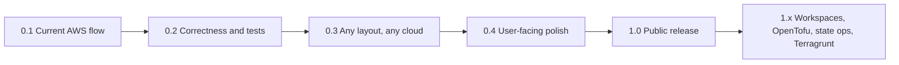

## prod_001_lazytf_a_keyboard_driven_terraform_cockpit - LazyTF: a keyboard-driven Terraform cockpit
> Date: 2026-10-16
> Status: Proposed
> Related request: `req_000_lazytf_1_0_public_release`
> Related backlog: (none yet)
> Related task: (none yet)
> Related architecture: (none yet)
> Reminder: Update status, linked refs, scope, decisions, success signals, and open questions when you edit this doc.

# Overview
LazyTF is a lazygit-style terminal UI for Terraform. It finds the Terraform projects and environments in a repo, and runs init, plan, apply and destroy with single keypresses. Output streams live, and a navigable plan summary groups changes by module. It wraps the real `terraform` binary and never touches state on its own, so anything it does can be repeated or checked on the plain CLI.

It is for engineers who run Terraform by hand every day across several environments (dev/staging/prod) and several root modules, and who are tired of retyping `-var-file` and `-backend-config` flags or applying against the wrong environment. That includes platform and DevOps engineers on AWS, GCP or Azure, consultants switching between client repos, and people learning Terraform who want to see what a plan will do before they apply it. They do not need to use the owner's AWS SSO + `variables/backend/` layout. Teams that run Terraform only through CI or a SaaS runner (Terraform Cloud, Spacelift, Atlantis) are not the core audience.

1.0 headline: **`brew install`/`yay -S` it, run `lazytf` in any Terraform repo, pick an environment and plan in three keypresses, with no flags to remember and no wrong-env applies.**

# Goals
- Any Terraform repo works after at most a few lines of config: env var-files, backend configs and the env/backend binding are configurable, and local backends and repos without per-env tfvars are supported.
- Auth is cloud-agnostic and optional: AWS SSO is one provider, alongside gcloud, az or a custom command. Nothing requires the AWS CLI.
- The current flow is correct: a saved plan is tied to its project and environment, plan/apply/destroy are never blocked or misrouted by an env name inferred from the state key, and confirm gates protect every destructive action.
- Installing takes one command on Linux and macOS (GitHub releases, AUR `lazytf-bin`, Homebrew tap, `go install`), under a clear licence, with a README that shows a demo.

# Non-goals
- Replacing Terraform Cloud, Atlantis or CI pipelines: LazyTF is a local, interactive front end.
- Editing `.tf` code, managing providers or modules, or cost estimation.
- Windows builds in 1.0 (the plan file path and shell assumptions are Unix-only today; revisit after 1.0).
- Workspaces, OpenTofu certification, state surgery and Terragrunt in 1.0 (planned for 1.1 to 1.3).
- Telemetry of any kind.

# Scope and guardrails
- In: correctness and tests of the init/plan/apply/destroy flow, configurable layout, pluggable auth, first-run experience and error messages, LICENSE, GoReleaser for linux/darwin amd64/arm64, AUR, Homebrew tap, `go install`, README with demo, CI (build, test, lint).
- Out: workspaces, OpenTofu certification, state operations, `-target`/`-replace`, Terragrunt, multi-project runs, Windows (all post-1.0).
- Guardrail: correctness before generalisation, generalisation before polish, polish before distribution; new ideas go to 1.1 or later unless they block a 1.0 exit signal.
- Guardrail: LazyTF only shells out to the user's own binaries; it never stores credentials and never runs apply or destroy without an explicit confirmation.

# Comparison with existing Terraform TUIs
- `idoavrah/terraform-tui` (`tftui`, Python/Textual, pip and Homebrew): state-first. It browses the state tree, taints, untaints and deletes resources, and newer releases plan and apply. It does not navigate between environments or projects.
- `lmarqs/terraform-ui` (`tfui`, Go/Bubble Tea, Homebrew/`go install`/mise, MIT, created May 2026): k9s-style plan, risk badges, blast radius and targeted apply for one project; supports terraform, tofu and terragrunt. It is the closest competitor and already ships the distribution LazyTF is aiming for.
- LazyTF's angle: lazygit-style navigation across many projects and environments, with env/backend pairing and a guard against plan/apply on the wrong environment. The other tools focus on a single project's state or plan.
- Open question: are there other active tools (for example plain `terraform` wrappers such as `tfswitch`/`tenv` or Terragrunt's own TUI) that users would compare LazyTF with? Check before writing the README "Why" section.

# Key product decisions
- 2025-12: Go + Bubble Tea, single static binary, shells out to `terraform`.
- 2026-07: Linux release via GoReleaser and CI with golangci-lint; v0.1.0 tagged.
- 2026-10-16 (proposed, owner to confirm): the 1.0 bar is "works on a stranger's repo and installs from a package manager", not feature parity with existing TUIs.
- 2026-10-16 (proposed, owner to confirm): MIT licence, matching the README's current claim.

# Success signals
- Three sample repos (local backend; GCS with plain tfvars; S3 with the owner's layout) plan and apply from LazyTF with config only.
- A tester who has never seen LazyTF plans a sample repo in under five minutes following only the README.
- `v1.0.0` installs and runs with `yay -S lazytf-bin`, `brew install`, and `go install` on clean Linux and macOS machines.
- After 1.0: GitHub stars, issues and AUR/Homebrew installs come from people other than the owner (the portfolio goal).

# References
- Product back-reference: `req_000_lazytf_1_0_public_release`
- Roadmap: `road_001_lazytf_to_1_0`
- Task back-reference: (none yet)
- External: https://github.com/idoavrah/terraform-tui, https://github.com/lmarqs/terraform-ui
