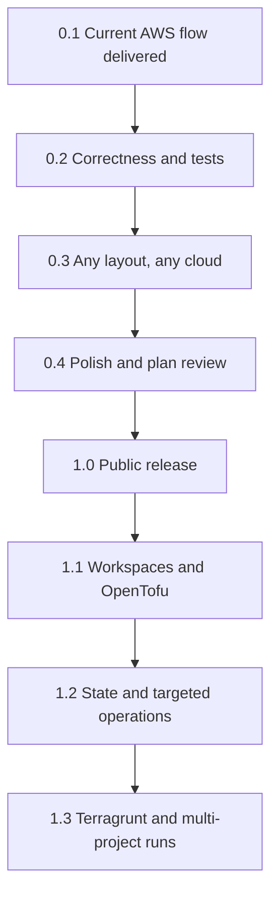

## road_001_lazytf_to_1_0 - LazyTF to 1.0
> Date: 2026-10-16
> Status: Proposed
> Related product: `prod_001_lazytf_a_keyboard_driven_terraform_cockpit`
> Related request: `req_000_lazytf_1_0_public_release`
> Reminder: Update status, milestone scope, linked refs, risks, and success signals when you edit this doc.
> Indicators reviewed: 2026-10-16 00:34:06

# AI Context
- Summary: Roadmap for LazyTF from the working 0.1.0 AWS-SSO + tfvars flow to a public 1.0 that strangers install from GitHub releases, AUR, Homebrew or `go install`, then post-1.0 depth.
- Keywords: roadmap, milestones, versions, lazytf, terraform, tui, 1.0, goreleaser, aur, homebrew, layout, auth
- Use when: Planning or sequencing versions for LazyTF.
- Skip when: You need execution details for a single backlog item; open the item instead.

# Summary
Owner decisions 2026-10-16 (see the product brief): 1.0 bar, MIT, OpenTofu binary in 0.3 and full support in 1.1, env binding read from Terraform's own `.terraform/terraform.tfstate`, GoReleaser-automated AUR and Homebrew, unsigned macOS, no Windows in 1.0, `tfui` as inspiration for plan review. Ordering: correctness and tests of the current init/plan/apply/destroy flow, then removing the assumptions that only fit the owner's setup (tfvars and backend layout, env detection from the S3 key, AWS SSO), then user-facing polish, then distribution. Today (v0.1.0, tagged, Linux-only release) LazyTF works end to end for one layout: one `*.tfvars` per environment, `variables/backend/**/backend_<env>.tfvars`, a remote backend whose state key starts with the env name, and AWS SSO. 1.0 means a stranger installs it with their package manager, runs it in their own Terraform repo and can plan and apply without renaming files. Scope freeze once accepted: new ideas go to 1.1 or later unless they block a 1.0 exit signal.

# Milestones
## 0.1 - Current AWS flow (delivered)
- Goal: A usable keyboard-driven Terraform loop for the owner's own repos.
- Scope: Project discovery (single project when `.terraform/` exists, otherwise scan of `search_paths`); environments from `*.tfvars` in `.`, `variables/`, `env/`, `tfvars/`; backend auto-match from `variables/backend/**/backend_<env>.tfvars`; init, plan (saved to `/tmp/lazytf-<project>.tfplan`), apply from saved or fresh plan, destroy with a confirm gate; streaming output; plan summary grouped by module; AWS SSO login with retry after a credential error; help modal; Catppuccin theme; optional `~/.config/lazytf/config.yml`; CI (build, vet, gofmt, test, golangci-lint); GoReleaser Linux amd64/arm64; tag v0.1.0; table-driven tests for the arg builders.
- Exit signal: Met: `go build ./...` and `go test ./...` pass (2026-10-16) and the owner runs it on their own infra repos.

## 0.2 - Current flow correctness and tests
- `item_000_current_flow_correctness_and_tests`: Current flow correctness and tests
- Goal: The existing flow is correct and tested before anything is generalised.
- Scope: Saved plan keyed by project path and environment (not `/tmp/lazytf-<basename>`), stale-plan detection on env switch; config defaults merged with a partial `config.yml`; non-interactive flags (`-input=false`) where stdin is not wired; process cancellation and exit codes surfaced; unit tests for discovery, var-file and backend matching, env inference, config loading and plan-summary grouping; a fixture-based integration test against a local-backend project with a real `terraform` binary in CI.
- Exit signal: The checks in item_000 pass, test coverage exists for every package except `ui`, and no known correctness bug is open.

## 0.3 - Any layout, any cloud
- `item_001_configurable_project_env_and_backend_layout`: Configurable project, environment and backend layout
- `item_002_cloud_agnostic_auth_and_credential_hooks`: Cloud-agnostic auth and credential hooks
- Goal: LazyTF works on a stranger's Terraform repo without renaming files and without AWS.
- Scope: Per-repo and global config for var-file globs, backend-config globs and the env-name pattern; env/backend binding read from the backend recorded by the last `terraform init` in `.terraform/terraform.tfstate` instead of inferred from the state key, with optional `.lazytf.yml` overrides for layout only; local backend and "no tfvars" projects supported; non-environment tfvars (`terraform.tfvars`, `*.auto.tfvars`, shared files) handled; configurable `terraform` binary; auth as an optional, pluggable pre-step (AWS SSO, `gcloud auth login`, `az login`, or a custom command) with error patterns per provider; AWS becomes one provider, not the default path.
- Exit signal: The three sample repos in item_001 (local backend, GCS with plain tfvars, S3 with the owner's layout) plan and apply from LazyTF with config only, and the AWS CLI is not required to start or use it.

## 0.4 - User-facing polish and plan review
- `item_003_first_run_error_messages_and_ui_polish`: First run, error messages and UI polish
- Goal: The first five minutes work for someone who has never seen LazyTF, and a plan is easy to judge before apply.
- Scope: Plan review read from `terraform show -json`: resources grouped by action, destroy and replace counted and highlighted with risk badges and blast radius, attribute diff per resource, and the counts repeated in the apply confirm (inspired by `tfui`); Clear empty states (no projects found, no environments, terraform not on PATH), `--version`, `--help`, `--config` and a path argument; no implicit scan of `~/Projects` and `~/Documents`; keybind consistency between README, status bar and help; colours taken from the terminal's ANSI palette instead of hardcoded Catppuccin hex, so LazyTF follows the terminal theme; small-terminal and light-terminal checks; search-path performance check on a large home directory.
- Exit signal: A tester who has never seen LazyTF plans a sample repo in under five minutes following only the README, on Linux and macOS, and the apply confirm shows how many resources will be destroyed or replaced.

## 1.0 - Public release
- `item_004_release_packaging_license_goreleaser_aur_homebrew`: Release packaging: LICENSE, GoReleaser, AUR, Homebrew
- `item_005_public_readme_with_demo_and_install_matrix`: Public README with demo and install matrix
- Goal: A stranger can install LazyTF with their usual package manager and trust it on real infrastructure.
- Scope: MIT LICENSE file (owner confirmed 2026-10-16); GoReleaser builds for linux and darwin, amd64 and arm64 (no Windows in 1.0; macOS unsigned, with the Gatekeeper workaround in the README), published as GitHub releases with checksums and version ldflags; AUR package `lazytf-bin` generated by GoReleaser; Homebrew tap (`Nicolas-Rigaudy/homebrew-tap`); documented `go install github.com/Nicolas-Rigaudy/lazytf/cmd/lazytf@latest`; README with a demo GIF or asciinema cast, install matrix, configuration reference and a safety note on apply/destroy; CI kept green on build, test and lint, plus a GoReleaser snapshot check on pull requests; CHANGELOG and a SECURITY/issue template.
- Exit signal: Tag `v1.0.0` produces a GitHub release with four archives; `yay -S lazytf-bin`, `brew install Nicolas-Rigaudy/tap/lazytf` and `go install ...@latest` each give a working `lazytf --version` on a clean machine.

## 1.1 - Workspaces and OpenTofu
- Goal: Cover the two most common setups that 1.0 leaves out.
- Scope: Terraform workspaces as an environment source (list, select, new); OpenTofu verified end to end (`tofu` binary, plan JSON compatibility) and listed as supported.
- Exit signal: A workspace-based repo and an OpenTofu repo each plan and apply from LazyTF with no tfvars-per-env convention.

## 1.2 - State and targeted operations
- Goal: Do the everyday state chores without leaving the TUI.
- Scope: State list and show, `-target` and `-replace` from the plan summary, `state rm`/`mv` behind a confirm gate, `validate` and `fmt` shortcuts.
- Exit signal: Replacing one resource from the plan summary takes one selection and one confirm, and every state-mutating action has a confirm gate.

## 1.3 - Terragrunt and multi-project runs
- Goal: Serve monorepos with many stacks.
- Scope: Terragrunt detection and `terragrunt` as the runner; plan several projects in sequence with a combined summary; per-project run history.
- Exit signal: A terragrunt monorepo with at least three units plans from one keypress and shows one combined summary.

# Sequencing
- Deliver milestones in ascending version order unless dependencies force a documented exception.
- 0.2 gates everything: no generalisation on top of the current env-detection and plan-file bugs.
- 0.3 is the real 1.0 blocker: without it LazyTF refuses to plan for most repos it does not recognise. item_001 lands before item_002 because auth depends on where env config lives.
- The GoReleaser and AUR/Homebrew parts of item_004 can land any time; the README demo in item_005 waits for 0.4 so it shows the final look.
- Keep each increment independently reviewable, covered by unit tests for pure logic, and linked to concrete workflow docs.

# Risks
- Running apply and destroy for strangers carries real blast radius; the confirm gates and saved-plan handling must be right before distribution, not after.
- Layout config may not fit every repo; config must cover the common shapes (tfvars per env, workspaces later, backend files), not every one.
- An existing Go Bubble Tea Terraform TUI (lmarqs/terraform-ui, `tfui`) already ships on Homebrew and `go install`; LazyTF competes on lazygit-style multi-project and environment navigation and borrows its best plan-review ideas (0.4) rather than chasing feature parity.
- Package channels (AUR, Homebrew tap) add maintenance per release; GoReleaser must own them so a release stays one tag push.
- Version labels are planning targets, not release promises.

# References
- Product brief(s): `prod_001_lazytf_a_keyboard_driven_terraform_cockpit`
- Request(s): `req_000_lazytf_1_0_public_release`
- Backlog item(s): see milestones
- Task(s): (none yet)
